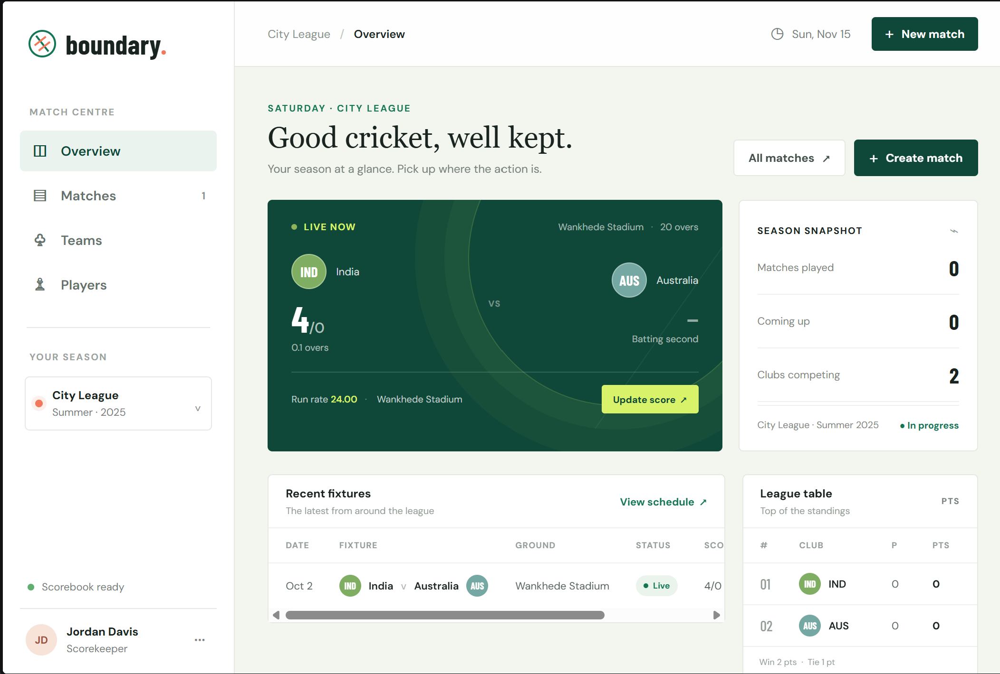
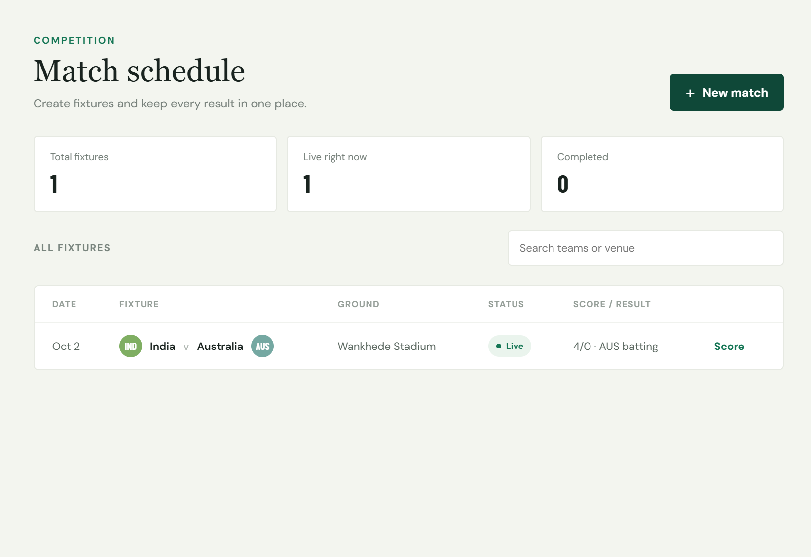
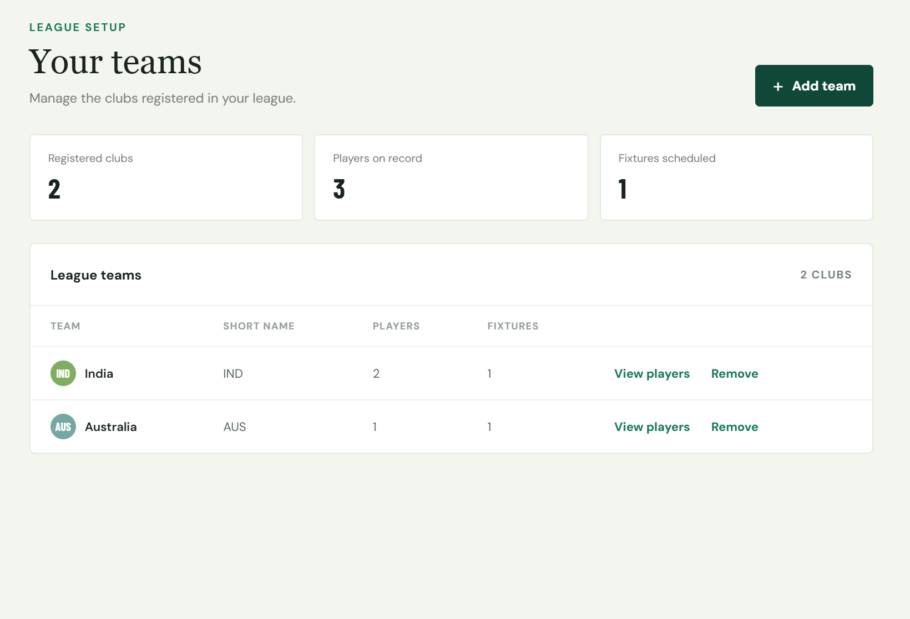
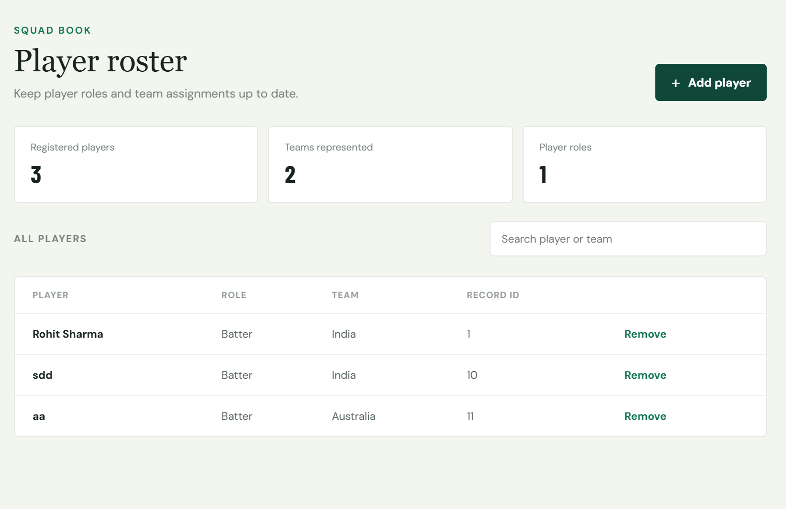

# Cricket Score Management System

Boundary is a web-based cricket scorebook for managing teams, player rosters, fixtures, and live match scores. The application combines a Spring Boot REST API with a responsive HTML, CSS, and JavaScript interface.

## Screenshots

### Dashboard



### Match schedule



### Teams



### Players



## Features

- Season overview with live scores, recent fixtures, and league standings.
- Create, update, and remove teams and players.
- Schedule fixtures and track upcoming, live, and completed matches.
- Start and complete matches, and record ball-by-ball scoring events.
- Manage data through the web interface or REST API.

## Technology

- Java 17
- Spring Boot 4.1.1, Spring Web MVC, and Spring Data JPA
- MySQL 8+
- Maven
- HTML, CSS, and vanilla JavaScript

## Getting started

### Prerequisites

- JDK 17 or later
- MySQL 8 or later

### Configure the database

Create the database:

```sql
CREATE DATABASE cricket_score_db;
```

The application uses the `local` profile by default and connects to `jdbc:mysql://localhost:3306/cricket_score_db`. Set the `DB_PASSWORD` environment variable to your MySQL password, or add your local credentials to `src/main/resources/application-local.properties`. That local properties file is excluded from Git.

In PowerShell, set the password for the current terminal session with:

```powershell
$env:DB_PASSWORD = "your_mysql_password"
```

### Run the application

From the project directory, start Spring Boot:

```powershell
.\mvnw.cmd spring-boot:run
```

Open [http://localhost:8080](http://localhost:8080) in your browser.

### Run the tests

```powershell
.\mvnw.cmd test
```

## REST API

All endpoints are under `/api`. Request and response bodies use JSON.

| Method | Endpoint | Description |
| --- | --- | --- |
| `GET` | `/api/teams` | List teams |
| `POST` | `/api/teams` | Create a team |
| `PUT` | `/api/teams/{id}` | Update a team |
| `DELETE` | `/api/teams/{id}` | Delete a team |
| `GET` | `/api/players` | List players; optionally filter with `?teamId={id}` |
| `POST` | `/api/players` | Create a player |
| `PUT` | `/api/players/{id}` | Update a player |
| `DELETE` | `/api/players/{id}` | Delete a player |
| `GET` | `/api/matches` | List matches |
| `POST` | `/api/matches` | Create a match |
| `POST` | `/api/matches/{id}/start` | Start a match |
| `POST` | `/api/matches/{id}/complete` | Complete a match |
| `POST` | `/api/matches/{id}/events` | Record a scoring event |

Example request bodies:

**`POST /api/teams`**

```json
{
  "name": "Harbour Cricket Club",
  "shortName": "HCC"
}
```

**`POST /api/players`**

```json
{
  "name": "Alex Morgan",
  "role": "Batter",
  "teamId": 1
}
```

**`POST /api/matches`**

```json
{
  "homeId": 1,
  "awayId": 2,
  "venue": "City Ground",
  "date": "2026-11-15",
  "overs": 20
}
```

**`POST /api/matches/{id}/events`**

```json
{
  "runs": 4,
  "extraRuns": 0,
  "extraType": null,
  "wicket": false,
  "wicketType": null
}
```
